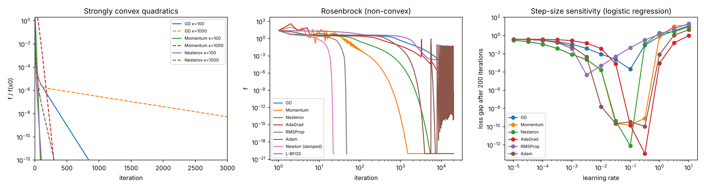
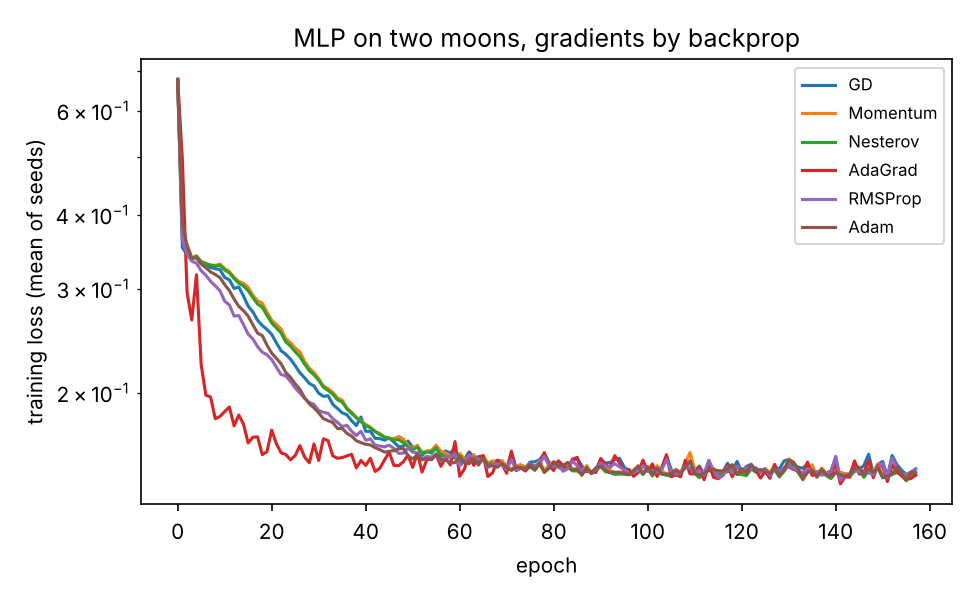

# Track A results (generated by run_experiments.py)

Python 3.13.18, NumPy 2.5.3, Linux-6.18.44-fc-v185-x86_64-with-glibc2.39. All optimizers implemented from scratch in `contopt/optimizers.py`. Learning rates tuned from the grid 1e-5 … 10 (half-decade steps) where marked.

## Exp 1 — convergence vs theory

| problem | method | iters_to_1e8_reduction | theory_iters | final_f |
|---|---|---|---|---|
| quadratic kappa=10 | GD (lr = 1/L) | 49 | ≤ 88 (bound) |  |
| quadratic kappa=10 | Momentum (Polyak optimal) | 17 | ≈ 15 (asymptotic) |  |
| quadratic kappa=10 | Nesterov (lr = 1/L) | 19 | ≤ 49 (bound) |  |
| quadratic kappa=10 | Newton | 1 | 1 (exact on a quadratic) |  |
| quadratic kappa=100 | GD (lr = 1/L) | 383 | ≤ 917 (bound) |  |
| quadratic kappa=100 | Momentum (Polyak optimal) | 63 | ≈ 46 (asymptotic) |  |
| quadratic kappa=100 | Nesterov (lr = 1/L) | 55 | ≤ 175 (bound) |  |
| quadratic kappa=100 | Newton | 1 | 1 (exact on a quadratic) |  |
| quadratic kappa=1000 | GD (lr = 1/L) | 2695 | ≤ 9206 (bound) |  |
| quadratic kappa=1000 | Momentum (Polyak optimal) | 220 | ≈ 146 (asymptotic) |  |
| quadratic kappa=1000 | Nesterov (lr = 1/L) | 138 | ≤ 574 (bound) |  |
| quadratic kappa=1000 | Newton | 1 | 1 (exact on a quadratic) |  |
| quartic (convex, not strongly) | GD (lr 0.02) | None | sublinear; fitted f(k) ~ k^-1.96 |  |
| Rosenbrock (non-convex) | GD (lr 1e-03) | None |  | 1.9e-08 |
| Rosenbrock (non-convex) | Momentum (lr 3e-03) | 551 |  | 1.1e-29 |
| Rosenbrock (non-convex) | Nesterov (lr 1e-03) | 1982 |  | 7.7e-30 |
| Rosenbrock (non-convex) | AdaGrad (lr 1e+00) | 11276 |  | 4.2e-13 |
| Rosenbrock (non-convex) | RMSProp (lr 1e-03) | None |  | 2.3e-04 |
| Rosenbrock (non-convex) | Adam (lr 3e-02) | 2571 |  | 5.3e-10 |
| Rosenbrock (non-convex) | Newton (damped) | 20 |  | 0.0e+00 |
| Rosenbrock (non-convex) | L-BFGS | 44 |  | 4.6e-28 |
| Rosenbrock (non-convex) | Newton-CG (HVP) | 20 |  | 0.0e+00 |

## Exp 2 — landscapes: saddle point and multiple minima

| landscape | method | outcome | f_final | iters_to_f_below_minus_0_99 |
|---|---|---|---|---|
| saddle | Newton (pure) | stops at [ 0. -0.] | -0.0 | None |
| saddle | Newton (damped: -g when H not PD) | x = [0.     1.4142] | -1.0 | 14 |
| saddle | GD (lr 0.1) | x = [0.     1.4142] | -1.0 | 83 |
| saddle | Momentum (lr 0.05) | x = [-0.      1.4142] | -1.0 | 54 |
| saddle | Nesterov (lr 0.05) | x = [0.     1.4142] | -1.0 | 54 |
| saddle | Adam (lr 0.05) | x = [-0.      1.4142] | -1.0 | 27 |
| saddle | RMSProp (lr 0.05) | x = [0.025  1.4386] | -0.99817 | 19 |
| saddle | AdaGrad (lr 0.5) | x = [0.     1.4142] | -1.0 | 4 |
| six-hump camel, 200 random starts | GD | global min 109, local min 91, saddle / max 0, not converged 0 |  |  |
| six-hump camel, 200 random starts | Momentum | global min 115, local min 85, saddle / max 0, not converged 0 |  |  |
| six-hump camel, 200 random starts | Adam | global min 108, local min 85, saddle / max 0, not converged 7 |  |  |
| six-hump camel, 200 random starts | Newton (pure) | global min 39, local min 67, saddle / max 94, not converged 0 |  |  |
| six-hump camel, 200 random starts | Newton (damped) | global min 115, local min 85, saddle / max 0, not converged 0 |  |  |
| six-hump camel, 200 random starts | L-BFGS | global min 127, local min 73, saddle / max 0, not converged 0 |  |  |

## Exp 3 — ML as optimization: L2 logistic regression (f* = 0.284962 from Newton)

| method | runs | loss_gap | test_acc | epochs_or_iterations | seconds | notes |
|---|---|---|---|---|---|---|
| GD (full batch, lr 1e-01) | 1 | 1.1e-03 | 0.842 | 100 | 0.008 | tuned lr |
| Momentum (full batch, lr 1e-01) | 1 | 7.0e-06 | 0.840 | 100 | 0.014 | tuned lr |
| Nesterov (full batch, lr 1e-01) | 1 | 2.3e-07 | 0.840 | 100 | 0.010 | tuned lr |
| AdaGrad (full batch, lr 3e-01) | 1 | 3.6e-12 | 0.842 | 100 | 0.008 | tuned lr |
| RMSProp (full batch, lr 1e-02) | 1 | 4.3e-04 | 0.840 | 100 | 0.008 | tuned lr |
| Adam (full batch, lr 3e-02) | 1 | 5.9e-06 | 0.842 | 100 | 0.013 | tuned lr |
| SGD (batch 1, lr 1e-04) | 5 | 3.0e-03 ± 1e-04 | 0.842 | 100 | 2.047 | tuned on seed 99 |
| Adam (batch 1, lr 1e-04) | 5 | 1.3e-03 ± 9e-05 | 0.841 | 100 | 2.928 | tuned on seed 99 |
| mini-batch SGD (batch 32, lr 3e-03) | 5 | 3.0e-03 ± 1e-04 | 0.842 | 100 | 0.070 | tuned on seed 99 |
| Adam (batch 32, lr 1e-03) | 5 | 8.4e-04 ± 1e-04 | 0.840 | 100 | 0.083 | tuned on seed 99 |
| Newton | 1 | 0.0e+00 | 0.842 | 7 | 0.001 | 1 grad + 1 Hessian (d^2 n) per iter; iterations to gap<1e-8: 6 |
| Newton-CG (Hessian-vector products) | 1 | 0.0e+00 | 0.842 | 7 | 0.005 | HVPs, Hessian never formed; iterations to gap<1e-8: 6; 90 HVPs |
| L-BFGS (low-rank curvature) | 1 | 2.5e-14 | 0.842 | 100 | 0.027 | 1 grad (+ line search) per iter; iterations to gap<1e-8: 31 |
| natural gradient (empirical Fisher) | 1 | -5.6e-17 | 0.842 | 100 | 0.017 | Fisher d^2 n per iter; iterations to gap<1e-8: 11 |
| diagonal-Hessian scaled GD | 1 | 2.8e-10 | 0.842 | 100 | 0.016 | diag(H) per iter; iterations to gap<1e-8: 82 |

### Regularization

| lam | weight_norm | train_acc | test_acc | hessian_min_eig |
|---|---|---|---|---|
| 0.0 | 0.846 | 0.863 | 0.842 | 7.68e-02 |
| 0.001 | 0.842 | 0.863 | 0.842 | 7.80e-02 |
| 0.1 | 0.634 | 0.852 | 0.842 | 1.92e-01 |
| 1.0 | 0.345 | 0.853 | 0.83 | 1.14e+00 |

## Exp 4 — nonlinear least squares

| start | method | iterations_to_optimum | final_f | reached_optimum | theta |
|---|---|---|---|---|---|
| near start (1, 0.2, 0) | Gauss-Newton | 11 | 0.0882581 | True | [2.499, 1.345, 0.519] |
| near start (1, 0.2, 0) | Levenberg-Marquardt | 4 | 0.0882581 | True | [2.499, 1.345, 0.519] |
| near start (1, 0.2, 0) | Newton (damped, exact Hessian) | 10 | 0.0882581 | True | [2.499, 1.345, 0.519] |
| near start (1, 0.2, 0) | GD (tuned) | 302 | 0.0882581 | True | [2.499, 1.345, 0.519] |
| near start (1, 0.2, 0) | Adam (tuned) | 811 | 0.0882581 | True | [2.499, 1.345, 0.519] |
| far start (0.1, 4, -2) | Gauss-Newton | None | 17.0199 | False | [-0.0, -118.36, 0.635] |
| far start (0.1, 4, -2) | Levenberg-Marquardt | 12 | 0.0882581 | True | [2.499, 1.345, 0.519] |
| far start (0.1, 4, -2) | Newton (damped, exact Hessian) | 22 | 0.0882581 | True | [2.499, 1.345, 0.519] |
| far start (0.1, 4, -2) | GD (tuned) | 465 | 0.0882581 | True | [2.499, 1.345, 0.519] |
| far start (0.1, 4, -2) | Adam (tuned) | 218 | 0.0882581 | True | [2.499, 1.345, 0.519] |

## Exp 5 — backpropagation: MLP (2-16-2) on two moons

| optimizer | lr | seeds | train_loss | test_acc |
|---|---|---|---|---|
| GD (mini-batch 32) | 3e-01 | 5 | 0.149 ± 0.004 | 0.949 ± 0.008 |
| Momentum (mini-batch 32) | 3e-02 | 5 | 0.146 ± 0.004 | 0.949 ± 0.008 |
| Nesterov (mini-batch 32) | 3e-02 | 5 | 0.145 ± 0.004 | 0.951 ± 0.007 |
| AdaGrad (mini-batch 32) | 1e+00 | 5 | 0.145 ± 0.003 | 0.953 ± 0.008 |
| RMSProp (mini-batch 32) | 1e-02 | 5 | 0.148 ± 0.004 | 0.947 ± 0.011 |
| Adam (mini-batch 32) | 1e-02 | 5 | 0.147 ± 0.004 | 0.951 ± 0.005 |

Gradient check: parameters = 82, max_abs_diff = 1.2e-10, backprop_ms = 0.32, finite_diff_ms = 21.3, forward_passes_backprop = 1 forward + 1 backward, forward_passes_finite_diff = 164

## Exp 6 — step-size sensitivity

| problem | method | best_lr | best_gap | good_lr_range | good_range_decades | smallest_diverging_lr |
|---|---|---|---|---|---|---|
| logistic | GD | 1e-01 | 2.0e-04 | 1e-01 – 1e-01 | 0.0 | none ≤ 10 |
| logistic | Momentum | 1e-01 | 1.6e-10 | 3e-02 – 3e-01 | 1.0 | none ≤ 10 |
| logistic | Nesterov | 1e-01 | 8.2e-13 | 3e-02 – 1e-01 | 0.5 | none ≤ 10 |
| logistic | AdaGrad | 3e-01 | 1.1e-13 | 1e-01 – 3e-01 | 0.5 | none ≤ 10 |
| logistic | RMSProp | 3e-03 | 4.9e-05 | 3e-03 – 1e-02 | 0.5 | none ≤ 10 |
| logistic | Adam | 3e-01 | 1.1e-10 | 1e-02 – 3e-01 | 1.5 | none ≤ 10 |
| Rosenbrock | GD | 1e-03 | 2.5e-02 | 1e-03 – 1e-03 | 0.0 | 1e-02 |
| Rosenbrock | Momentum | 3e-03 | 2.0e-29 | 1e-03 – 3e-03 | 0.5 | 1e-02 |
| Rosenbrock | Nesterov | 1e-03 | 2.2e-12 | 1e-03 – 1e-03 | 0.0 | 3e-03 |
| Rosenbrock | AdaGrad | 1e+00 | 9.1e-04 | 3e-01 – 1e+00 | 0.5 | none ≤ 10 |
| Rosenbrock | RMSProp | 3e-03 | 2.5e-03 | 1e-03 – 1e-02 | 1.0 | none ≤ 10 |
| Rosenbrock | Adam | 3e+00 | 8.4e-13 | 3e-02 – 3e+00 | 2.0 | none ≤ 10 |

## Exp 7 — noisy objectives

| experiment | setting | epochs | gap_mean | gap_std |
|---|---|---|---|---|
| SGD batch size | batch 1, lr 0.05, constant lr | 50 | 9.11e-01 | 2.4e-01 |
| SGD batch size | batch 1, lr 0.05, lr/sqrt(k) | 50 | 2.97e-03 | 6.4e-04 |
| SGD batch size | batch 8, lr 0.05, constant lr | 50 | 5.87e-02 | 1.9e-02 |
| SGD batch size | batch 8, lr 0.05, lr/sqrt(k) | 50 | 3.35e-03 | 2.5e-04 |
| SGD batch size | batch 64, lr 0.05, constant lr | 50 | 7.85e-03 | 3.9e-03 |
| SGD batch size | batch 64, lr 0.05, lr/sqrt(k) | 50 | 8.99e-03 | 3.9e-04 |
| SGD batch size | batch full, lr 0.05, constant lr | 50 | 6.73e-03 | 0.0e+00 |
| SGD batch size | batch full, lr 0.05, lr/sqrt(k) | 50 | 3.77e-02 | 0.0e+00 |
| additive gradient noise (quadratic kappa=100) | sigma 0.0, GD lr 0.01 | 3000 steps | 6.37e-28 | 0.0e+00 |
| additive gradient noise (quadratic kappa=100) | sigma 0.0, Momentum lr 0.002 | 3000 steps | 2.52e-71 | 0.0e+00 |
| additive gradient noise (quadratic kappa=100) | sigma 0.0, Adam lr 0.05 | 3000 steps | 4.05e-12 | 0.0e+00 |
| additive gradient noise (quadratic kappa=100) | sigma 0.1, GD lr 0.01 | 3000 steps | 7.87e-04 | 3.0e-04 |
| additive gradient noise (quadratic kappa=100) | sigma 0.1, Momentum lr 0.002 | 3000 steps | 1.07e-03 | 3.8e-04 |
| additive gradient noise (quadratic kappa=100) | sigma 0.1, Adam lr 0.05 | 3000 steps | 2.90e-03 | 9.6e-04 |
| additive gradient noise (quadratic kappa=100) | sigma 1.0, GD lr 0.01 | 3000 steps | 7.87e-02 | 3.0e-02 |
| additive gradient noise (quadratic kappa=100) | sigma 1.0, Momentum lr 0.002 | 3000 steps | 1.07e-01 | 3.8e-02 |
| additive gradient noise (quadratic kappa=100) | sigma 1.0, Adam lr 0.05 | 3000 steps | 7.82e-02 | 2.9e-02 |
| additive gradient noise (quadratic kappa=100) | sigma 10.0, GD lr 0.01 | 3000 steps | 7.87e+00 | 3.0e+00 |
| additive gradient noise (quadratic kappa=100) | sigma 10.0, Momentum lr 0.002 | 3000 steps | 1.07e+01 | 3.8e+00 |
| additive gradient noise (quadratic kappa=100) | sigma 10.0, Adam lr 0.05 | 3000 steps | 2.10e+00 | 5.1e-01 |

