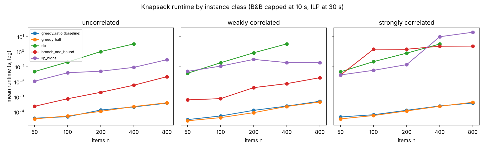
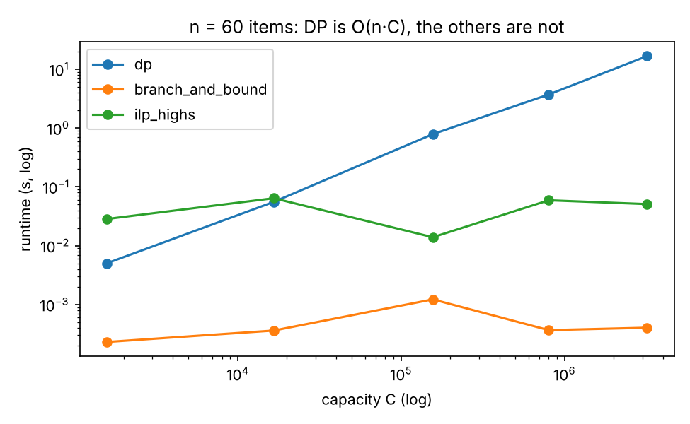

# Track B results (generated by run_experiments.py)

Mode: full. Python 3.13.18, x86_64. Values are recomputed from chosen items, never taken from a solver.

## Exp 1 — knapsack: gap to proven optimum and runtime

Reference = best value among runs that *proved* optimality. Greedy methods are heuristics, so `proven_optimal` is 0 for them by definition.

| kind | n | method | proven_optimal | gap_mean_pct | gap_max_pct | seconds_mean | nodes_mean |
|---|---|---|---|---|---|---|---|
| uncorrelated | 50 | greedy_ratio (baseline) | 0/3 | 0.329 | 0.987 | 3.96e-05 |  |
| uncorrelated | 50 | greedy_half | 0/3 | 0.329 | 0.987 | 3.55e-05 |  |
| uncorrelated | 50 | dp | 3/3 | 0.0 | 0.0 | 0.0493 |  |
| uncorrelated | 50 | branch_and_bound | 3/3 | 0.0 | 0.0 | 0.000244 | 156 |
| uncorrelated | 50 | ilp_highs | 3/3 | 0.0 | 0.0 | 0.0113 |  |
| uncorrelated | 100 | greedy_ratio (baseline) | 0/3 | 0.086 | 0.123 | 4.96e-05 |  |
| uncorrelated | 100 | greedy_half | 0/3 | 0.086 | 0.123 | 5.59e-05 |  |
| uncorrelated | 100 | dp | 3/3 | 0.0 | 0.0 | 0.213 |  |
| uncorrelated | 100 | branch_and_bound | 3/3 | 0.0 | 0.0 | 0.000775 | 522 |
| uncorrelated | 100 | ilp_highs | 3/3 | 0.0 | 0.0 | 0.0411 |  |
| uncorrelated | 200 | greedy_ratio (baseline) | 0/3 | 0.088 | 0.183 | 0.000138 |  |
| uncorrelated | 200 | greedy_half | 0/3 | 0.088 | 0.183 | 0.000113 |  |
| uncorrelated | 200 | dp | 3/3 | 0.0 | 0.0 | 1.05 |  |
| uncorrelated | 200 | branch_and_bound | 3/3 | 0.0 | 0.0 | 0.00207 | 1066 |
| uncorrelated | 200 | ilp_highs | 3/3 | 0.0 | 0.0 | 0.052 |  |
| uncorrelated | 400 | greedy_ratio (baseline) | 0/3 | 0.014 | 0.017 | 0.000221 |  |
| uncorrelated | 400 | greedy_half | 0/3 | 0.014 | 0.017 | 0.000234 |  |
| uncorrelated | 400 | dp | 3/3 | 0.0 | 0.0 | 3.38 |  |
| uncorrelated | 400 | branch_and_bound | 3/3 | 0.0 | 0.0 | 0.00611 | 2053 |
| uncorrelated | 400 | ilp_highs | 3/3 | 0.0 | 0.0 | 0.0935 |  |
| uncorrelated | 800 | greedy_ratio (baseline) | 0/3 | 0.009 | 0.014 | 0.000393 |  |
| uncorrelated | 800 | greedy_half | 0/3 | 0.009 | 0.014 | 0.000417 |  |
| uncorrelated | 800 | branch_and_bound | 3/3 | 0.0 | 0.0 | 0.0226 | 3720 |
| uncorrelated | 800 | ilp_highs | 3/3 | 0.0 | 0.0 | 0.302 |  |
| weakly_correlated | 50 | greedy_ratio (baseline) | 0/3 | 0.331 | 0.719 | 3.18e-05 |  |
| weakly_correlated | 50 | greedy_half | 0/3 | 0.331 | 0.719 | 2.66e-05 |  |
| weakly_correlated | 50 | dp | 3/3 | 0.0 | 0.0 | 0.038 |  |
| weakly_correlated | 50 | branch_and_bound | 3/3 | 0.0 | 0.0 | 0.00065 | 1088 |
| weakly_correlated | 50 | ilp_highs | 3/3 | 0.0 | 0.0 | 0.0508 |  |
| weakly_correlated | 100 | greedy_ratio (baseline) | 0/3 | 0.147 | 0.343 | 5.55e-05 |  |
| weakly_correlated | 100 | greedy_half | 0/3 | 0.147 | 0.343 | 4.31e-05 |  |
| weakly_correlated | 100 | dp | 3/3 | 0.0 | 0.0 | 0.19 |  |
| weakly_correlated | 100 | branch_and_bound | 3/3 | 0.0 | 0.0 | 0.000785 | 1015 |
| weakly_correlated | 100 | ilp_highs | 3/3 | 0.0 | 0.0 | 0.113 |  |
| weakly_correlated | 200 | greedy_ratio (baseline) | 0/3 | 0.026 | 0.027 | 0.000131 |  |
| weakly_correlated | 200 | greedy_half | 0/3 | 0.026 | 0.027 | 9.2e-05 |  |
| weakly_correlated | 200 | dp | 3/3 | 0.0 | 0.0 | 0.868 |  |
| weakly_correlated | 200 | branch_and_bound | 3/3 | 0.0 | 0.0 | 0.00422 | 3665 |
| weakly_correlated | 200 | ilp_highs | 3/3 | 0.0 | 0.0 | 0.316 |  |
| weakly_correlated | 400 | greedy_ratio (baseline) | 0/3 | 0.012 | 0.019 | 0.000251 |  |
| weakly_correlated | 400 | greedy_half | 0/3 | 0.012 | 0.019 | 0.000238 |  |
| weakly_correlated | 400 | dp | 3/3 | 0.0 | 0.0 | 3.39 |  |
| weakly_correlated | 400 | branch_and_bound | 3/3 | 0.0 | 0.0 | 0.00777 | 5718 |
| weakly_correlated | 400 | ilp_highs | 3/3 | 0.0 | 0.0 | 0.194 |  |
| weakly_correlated | 800 | greedy_ratio (baseline) | 0/3 | 0.005 | 0.008 | 0.000527 |  |
| weakly_correlated | 800 | greedy_half | 0/3 | 0.005 | 0.008 | 0.00047 |  |
| weakly_correlated | 800 | branch_and_bound | 3/3 | 0.0 | 0.0 | 0.0193 | 9312 |
| weakly_correlated | 800 | ilp_highs | 3/3 | 0.0 | 0.0 | 0.195 |  |
| strongly_correlated | 50 | greedy_ratio (baseline) | 0/3 | 2.871 | 2.936 | 4.77e-05 |  |
| strongly_correlated | 50 | greedy_half | 0/3 | 2.871 | 2.936 | 3.55e-05 |  |
| strongly_correlated | 50 | dp | 3/3 | 0.0 | 0.0 | 0.0473 |  |
| strongly_correlated | 50 | branch_and_bound | 3/3 | 0.0 | 0.0 | 0.0288 | 70835 |
| strongly_correlated | 50 | ilp_highs | 3/3 | 0.0 | 0.0 | 0.0294 |  |
| strongly_correlated | 100 | greedy_ratio (baseline) | 0/3 | 1.391 | 1.703 | 6.69e-05 |  |
| strongly_correlated | 100 | greedy_half | 0/3 | 1.391 | 1.703 | 5.93e-05 |  |
| strongly_correlated | 100 | dp | 3/3 | 0.0 | 0.0 | 0.225 |  |
| strongly_correlated | 100 | branch_and_bound | 1/3 | 0.0 | 0.0 | 1.51 | 3383194 |
| strongly_correlated | 100 | ilp_highs | 3/3 | 0.0 | 0.0 | 0.0596 |  |
| strongly_correlated | 200 | greedy_ratio (baseline) | 0/3 | 0.558 | 0.872 | 0.000132 |  |
| strongly_correlated | 200 | greedy_half | 0/3 | 0.558 | 0.872 | 0.00012 |  |
| strongly_correlated | 200 | dp | 3/3 | 0.0 | 0.0 | 0.82 |  |
| strongly_correlated | 200 | branch_and_bound | 1/3 | 0.0 | 0.0 | 1.49 | 3425505 |
| strongly_correlated | 200 | ilp_highs | 3/3 | 0.0 | 0.0 | 0.142 |  |
| strongly_correlated | 400 | greedy_ratio (baseline) | 0/3 | 0.299 | 0.526 | 0.000256 |  |
| strongly_correlated | 400 | greedy_half | 0/3 | 0.299 | 0.526 | 0.000244 |  |
| strongly_correlated | 400 | dp | 3/3 | 0.0 | 0.0 | 3.31 |  |
| strongly_correlated | 400 | branch_and_bound | 0/3 | 0.025 | 0.075 | 2.37 | 5000001 |
| strongly_correlated | 400 | ilp_highs | 2/3 | 0.0 | 0.0 | 10.1 |  |
| strongly_correlated | 800 | greedy_ratio (baseline) | 0/3 | 0.143 | 0.257 | 0.000401 |  |
| strongly_correlated | 800 | greedy_half | 0/3 | 0.143 | 0.257 | 0.000451 |  |
| strongly_correlated | 800 | branch_and_bound | 0/3 | 0.015 | 0.044 | 2.41 | 5000001 |
| strongly_correlated | 800 | ilp_highs | 1/3 | 0.0 | 0.0 | 20.1 |  |

## Exp 2 — DP is pseudo-polynomial

| R | capacity | method | value | seconds | dp_table_cells |
|---|---|---|---|---|---|
| 100 | 1578 | dp | 1732 | 0.00501 | 94740 |
| 100 | 1578 | branch_and_bound | 1732 | 0.00023 |  |
| 100 | 1578 | ilp_highs | 1732 | 0.0284 |  |
| 1000 | 16613 | dp | 17953 | 0.0555 | 996840 |
| 1000 | 16613 | branch_and_bound | 17953 | 0.00036 |  |
| 1000 | 16613 | ilp_highs | 17953 | 0.0641 |  |
| 10000 | 156204 | dp | 171460 | 0.787 | 9372300 |
| 10000 | 156204 | branch_and_bound | 171460 | 0.00122 |  |
| 10000 | 156204 | ilp_highs | 171460 | 0.0139 |  |
| 50000 | 799703 | dp | 886670 | 3.72 | 47982240 |
| 50000 | 799703 | branch_and_bound | 886670 | 0.000366 |  |
| 50000 | 799703 | ilp_highs | 886670 | 0.0591 |  |
| 200000 | 3198768 | dp | 3546675 | 16.7 | 191926140 |
| 200000 | 3198768 | branch_and_bound | 3546675 | 0.000402 |  |
| 200000 | 3198768 | ilp_highs | 3546675 | 0.0509 |  |

## Exp 3 — knapsack as QUBO: penalty weight

6 items, uncorrelated, brute-force ground state of the QUBO checked against the true optimum.

| penalty_over_max_value | instances | ground_state_feasible | ground_state_optimal | qubits |
|---|---|---|---|---|
| 0.001 | 30 | 0/30 | 0/30 | 6 items + 5 slack |
| 0.01 | 30 | 1/30 | 1/30 | 6 items + 5 slack |
| 0.05 | 30 | 14/30 | 14/30 | 6 items + 5 slack |
| 0.1 | 30 | 18/30 | 18/30 | 6 items + 5 slack |
| 0.2 | 30 | 25/30 | 25/30 | 6 items + 5 slack |
| 0.5 | 30 | 29/30 | 29/30 | 6 items + 5 slack |
| 1 | 30 | 30/30 | 30/30 | 6 items + 5 slack |
| 2 | 30 | 30/30 | 30/30 | 6 items + 5 slack |
| 5 | 30 | 30/30 | 30/30 | 6 items + 5 slack |

## Exp 4 — Max-Cut QUBO/Ising (input for Track C)

Graph: 10 nodes, 19 edges, optimum cut 14 (8 optimal bitstrings, incl. complements). Mean local-search approximation ratio 0.95. Instance saved to `maxcut_instance.json`.

| method | runs | best_cut | mean_cut | hit_optimum | seconds |
|---|---|---|---|---|---|
| brute force (2^10 states) | 1 | 14 | 14 | 1/1 | 0.0002 |
| one-flip local search | 200 | 14 | 13.29 | 78/200 |  |

## Exp 5 — feature selection (d = 12, k = 4, breast-cancer data)

Accuracy = 5-fold stratified CV of standardised logistic regression.

| method | evaluations | accuracy | features | seconds |
|---|---|---|---|---|
| exhaustive | 495 | 0.9455 | [1, 3, 6, 7] | 11.09 |
| greedy forward | 42 | 0.9438 | [1, 2, 7, 11] | 1.0 |
| random subsets (baseline, 10 seeds) | 42 | 0.9425 ± 0.0017 | best per seed varies |  |
