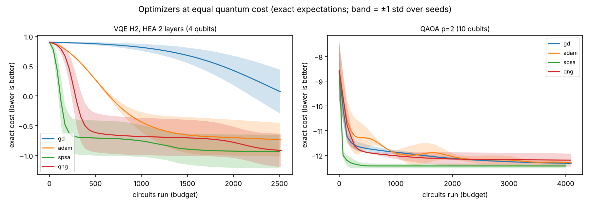
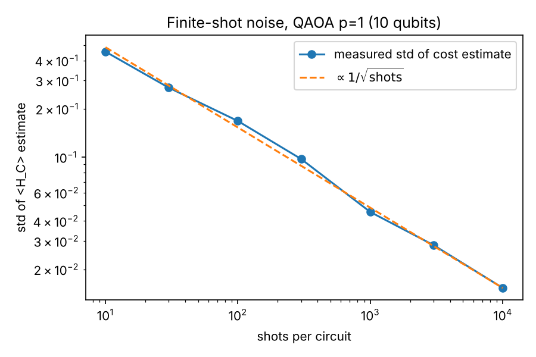
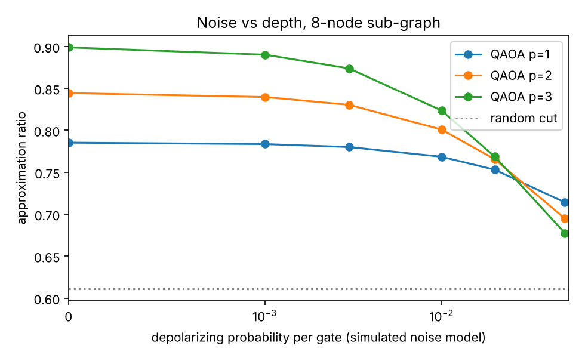
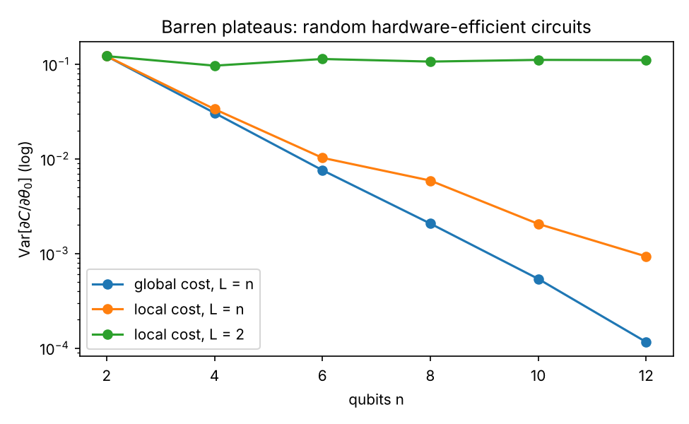
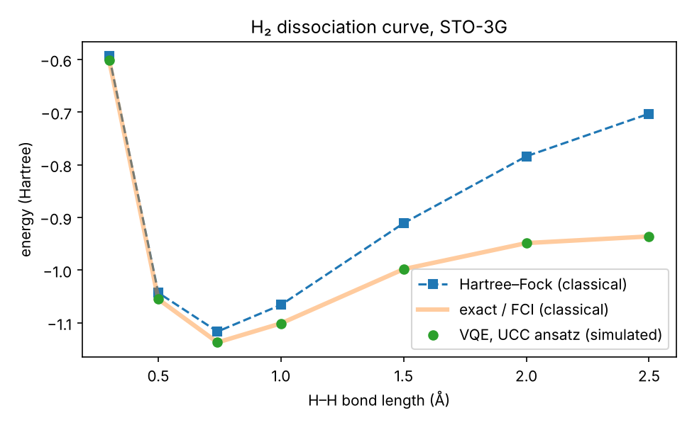

# Track C results (generated by run_experiments.py)

PennyLane 0.45.1. **All results are classical simulations** (`default.qubit` state vector; `default.mixed` density matrix for noise; `lightning.qubit` for barren plateaus). No real quantum hardware was used.

## Exp 1 — QAOA on the Track B Max-Cut (10 nodes, optimum 14)

Trained noiselessly with Adam (backprop on the simulator); mean ± std over seeds. `shots_for_99pct…` = shots needed to sample an optimal cut at least once with 99% probability.

| method | runs | params | approx_ratio | p_optimal | shots_for_99pct_to_see_optimum |
|---|---|---|---|---|---|
| QAOA p=1 | 5 | 2 | 0.838 ± 0.000 | 0.076 | 59 |
| QAOA p=2 | 5 | 4 | 0.886 ± 0.006 | 0.165 | 26 |
| QAOA p=3 | 5 | 6 | 0.906 ± 0.017 | 0.227 | 18 |
| QAOA p=4 | 5 | 8 | 0.932 ± 0.003 | 0.334 | 12 |
| brute force (classical, exact) | 1 |  | 1.000 | 1.000 | n/a |
| one-flip local search (Track B) | 200 |  | 0.949 | 78/200 | n/a |
| uniformly random cut | exact |  | 0.679 | 0.0078 | 588 |

## Exp 2 — optimizers at an equal budget of circuit runs

Budget counts distinct circuits run (`qml.Tracker` 'simulations'). Step size per method tuned on held-out seed 99 with exact expectations, then fixed. Cost = exact expectation at the final parameters; lower is better.

| problem | method | stepsize | shots | budget_circuits | seeds | final_cost_mean | final_cost_std | target | gap_mean |
|---|---|---|---|---|---|---|---|---|---|
| QAOA p=2 (10 qubits) | gd | 0.03 | exact | 4000 | 3 | -12.3267 | 0.0076 | -14 | 1.6733 |
| QAOA p=2 (10 qubits) | gd | 0.03 | 1000 | 4000 | 3 | -12.3241 | 0.0079 | -14 | 1.6759 |
| QAOA p=2 (10 qubits) | adam | 0.1 | exact | 4000 | 3 | -12.3055 | 0.0529 | -14 | 1.6945 |
| QAOA p=2 (10 qubits) | adam | 0.1 | 1000 | 4000 | 3 | -12.3181 | 0.0426 | -14 | 1.6819 |
| QAOA p=2 (10 qubits) | spsa | 0.3 | exact | 4000 | 3 | -12.4336 | 0.0952 | -14 | 1.5664 |
| QAOA p=2 (10 qubits) | spsa | 0.3 | 1000 | 4000 | 3 | -12.4947 | 0.0942 | -14 | 1.5053 |
| QAOA p=2 (10 qubits) | qng | 0.1 | exact | 4000 | 3 | -12.1972 | 0.264 | -14 | 1.8028 |
| QAOA p=2 (10 qubits) | qng | 0.1 | 1000 | 4000 | 3 | -12.2084 | 0.255 | -14 | 1.7916 |
| VQE H2, HEA 2 layers (4 qubits) | gd | 0.03 | exact | 2500 | 3 | 0.0708 | 0.3675 | -1.1373 | 1.208 |
| VQE H2, HEA 2 layers (4 qubits) | gd | 0.03 | 1000 | 2500 | 3 | 0.0636 | 0.3637 | -1.1373 | 1.2009 |
| VQE H2, HEA 2 layers (4 qubits) | adam | 0.03 | exact | 2500 | 3 | -0.7371 | 0.2813 | -1.1373 | 0.4002 |
| VQE H2, HEA 2 layers (4 qubits) | adam | 0.03 | 1000 | 2500 | 3 | -0.7557 | 0.2704 | -1.1373 | 0.3815 |
| VQE H2, HEA 2 layers (4 qubits) | spsa | 1.0 | exact | 2500 | 3 | -0.9337 | 0.2826 | -1.1373 | 0.2036 |
| VQE H2, HEA 2 layers (4 qubits) | spsa | 1.0 | 1000 | 2500 | 3 | -1.1354 | 0.0013 | -1.1373 | 0.0018 |
| VQE H2, HEA 2 layers (4 qubits) | qng | 0.1 | exact | 2500 | 3 | -0.9156 | 0.2795 | -1.1373 | 0.2217 |
| VQE H2, HEA 2 layers (4 qubits) | qng | 0.1 | 1000 | 2500 | 3 | -0.9041 | 0.2652 | -1.1373 | 0.2332 |

## Exp 3 — finite measurement shots (QAOA p = 1)

Cost spread measured at the trained parameters; gradient (d/dγ) spread measured at the untrained start, where the true gradient is non-zero.

| shots | repeats | exact_cost | cost_mean | cost_std | std_times_sqrt_shots | grad_exact_at_start | grad_std | grad_sign_wrong |
|---|---|---|---|---|---|---|---|---|
| 10 | 100 | -11.73 | -11.773 | 0.4541 | 1.436 |  |  |  |
| 30 | 100 | -11.73 | -11.7473 | 0.2711 | 1.485 |  |  |  |
| 100 | 100 | -11.73 | -11.7297 | 0.1679 | 1.679 | 5.5505 | 0.6706 | 0/20 |
| 300 | 100 | -11.73 | -11.7395 | 0.0974 | 1.688 |  |  |  |
| 1000 | 100 | -11.73 | -11.7259 | 0.0455 | 1.439 | 5.5505 | 0.246 | 0/20 |
| 3000 | 100 | -11.73 | -11.7336 | 0.0283 | 1.549 |  |  |  |
| 10000 | 100 | -11.73 | -11.7278 | 0.0153 | 1.535 | 5.5505 | 0.0665 | 0/20 |

## Exp 4 — hardware noise model (8-node induced sub-graph, 11 edges, optimum 9)

Simulated depolarizing channel after every gate: a simplified model, not a calibrated device. Random-cut ratio = 0.6111.

| qaoa_depth | noise | approx_ratio | p_optimal |
|---|---|---|---|
| 1 | 0.0 | 0.7853 | 0.0942 |
| 1 | 0.001 | 0.7836 | 0.0929 |
| 1 | 0.003 | 0.7801 | 0.0905 |
| 1 | 0.01 | 0.7685 | 0.0827 |
| 1 | 0.02 | 0.7531 | 0.0729 |
| 1 | 0.05 | 0.7141 | 0.0518 |
| 2 | 0.0 | 0.8444 | 0.1936 |
| 2 | 0.001 | 0.8397 | 0.1874 |
| 2 | 0.003 | 0.8304 | 0.1757 |
| 2 | 0.01 | 0.801 | 0.1413 |
| 2 | 0.02 | 0.7657 | 0.1057 |
| 2 | 0.05 | 0.6948 | 0.0519 |
| 3 | 0.0 | 0.8989 | 0.3747 |
| 3 | 0.001 | 0.8902 | 0.3555 |
| 3 | 0.003 | 0.8738 | 0.3204 |
| 3 | 0.01 | 0.8237 | 0.2257 |
| 3 | 0.02 | 0.7689 | 0.1424 |
| 3 | 0.05 | 0.6775 | 0.0489 |

## Exp 5 — barren plateaus

| qubits | layers | cost | samples | grad_mean | grad_variance |
|---|---|---|---|---|---|
| 2 | 2 | global | 200 | 1.84e-02 | 1.218e-01 |
| 2 | 2 | local | 200 | 1.84e-02 | 1.218e-01 |
| 2 | 2 | local | 200 | 1.84e-02 | 1.218e-01 |
| 4 | 4 | global | 200 | 1.90e-02 | 3.059e-02 |
| 4 | 4 | local | 200 | -5.20e-03 | 3.357e-02 |
| 4 | 2 | local | 200 | -3.66e-02 | 9.663e-02 |
| 6 | 6 | global | 200 | -1.14e-02 | 7.593e-03 |
| 6 | 6 | local | 200 | 7.15e-03 | 1.026e-02 |
| 6 | 2 | local | 200 | 1.93e-02 | 1.136e-01 |
| 8 | 8 | global | 200 | 5.62e-03 | 2.072e-03 |
| 8 | 8 | local | 200 | -4.30e-03 | 5.897e-03 |
| 8 | 2 | local | 200 | 3.16e-03 | 1.067e-01 |
| 10 | 10 | global | 200 | -9.18e-04 | 5.395e-04 |
| 10 | 10 | local | 200 | -6.64e-03 | 2.056e-03 |
| 10 | 2 | local | 200 | -1.54e-02 | 1.112e-01 |
| 12 | 12 | global | 200 | 3.73e-04 | 1.161e-04 |
| 12 | 12 | local | 200 | -1.55e-03 | 9.309e-04 |
| 12 | 2 | local | 200 | -3.61e-02 | 1.106e-01 |

## Exp 6 — VQE for H₂ (UCC ansatz, parameter-shift gradient descent, 60 steps)

Chemical accuracy = within 1.6 mHa of exact.

| bond_angstrom | hartree_fock | vqe_ucc | exact_fci | vqe_error_mHa | hf_error_mHa | chemical_accuracy | circuits |
|---|---|---|---|---|---|---|---|
| 0.3 | -0.593828 | -0.601804 | -0.601804 | 0.0 | 7.98 | True | 300 |
| 0.5 | -1.042996 | -1.05516 | -1.05516 | 0.0 | 12.16 | True | 300 |
| 0.7414 | -1.116684 | -1.13727 | -1.13727 | 0.0 | 20.59 | True | 300 |
| 1.0 | -1.066109 | -1.10115 | -1.10115 | 0.0 | 35.04 | True | 300 |
| 1.5 | -0.910874 | -0.998149 | -0.998149 | 0.0 | 87.28 | True | 300 |
| 2.0 | -0.783793 | -0.948641 | -0.948641 | 0.0001 | 164.85 | True | 300 |
| 2.5 | -0.702944 | -0.936055 | -0.936055 | 0.0002 | 233.11 | True | 300 |

