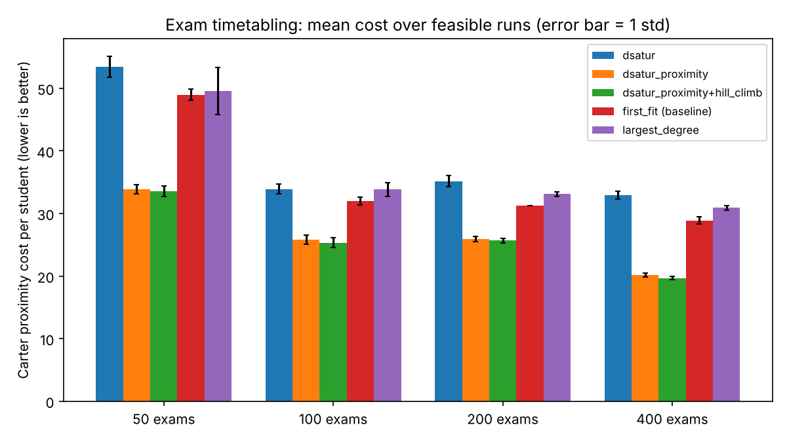

# Track E results (generated by run_experiments.py)

Cost = Carter proximity cost per student (lower is better), recomputed independently by `evaluate.py`. Mean and std over seeds; only feasible runs enter the cost mean.

## Experiment 1 — heuristics on synthetic instances

| exams | method | feasible | cost_mean | cost_std | slots_mean | seconds_mean |
|---|---|---|---|---|---|---|
| 50 | dsatur | 5/5 | 53.47 | 1.67 | 11.6 | 0.0023 |
| 50 | dsatur_proximity | 5/5 | 33.87 | 0.77 | 14 | 0.0033 |
| 50 | dsatur_proximity+hill_climb | 5/5 | 33.56 | 0.83 | 14 | 0.0014 |
| 50 | first_fit (baseline) | 3/5 | 48.95 | 0.88 | 13.3 | 0.0002 |
| 50 | largest_degree | 5/5 | 49.55 | 3.72 | 12.4 | 0.0001 |
| 100 | dsatur | 5/5 | 33.9 | 0.81 | 17.8 | 0.0152 |
| 100 | dsatur_proximity | 5/5 | 25.78 | 0.75 | 20 | 0.0187 |
| 100 | dsatur_proximity+hill_climb | 5/5 | 25.32 | 0.77 | 20 | 0.0074 |
| 100 | first_fit (baseline) | 4/5 | 31.96 | 0.62 | 19.8 | 0.0004 |
| 100 | largest_degree | 5/5 | 33.84 | 1.1 | 18 | 0.0004 |
| 200 | dsatur | 5/5 | 35.15 | 0.9 | 18 | 0.0589 |
| 200 | dsatur_proximity | 5/5 | 25.94 | 0.44 | 20 | 0.0678 |
| 200 | dsatur_proximity+hill_climb | 5/5 | 25.65 | 0.41 | 20 | 0.0169 |
| 200 | first_fit (baseline) | 1/5 | 31.24 |  | 20 | 0.0006 |
| 200 | largest_degree | 5/5 | 33.09 | 0.39 | 19.2 | 0.0007 |
| 400 | dsatur | 5/5 | 32.91 | 0.62 | 20 | 0.2974 |
| 400 | dsatur_proximity | 5/5 | 20.13 | 0.32 | 24 | 0.356 |
| 400 | dsatur_proximity+hill_climb | 5/5 | 19.66 | 0.25 | 24 | 0.0775 |
| 400 | first_fit (baseline) | 5/5 | 28.87 | 0.55 | 23.4 | 0.0016 |
| 400 | largest_degree | 5/5 | 30.88 | 0.39 | 21 | 0.0018 |

## Experiment 1b — minimum slots needed (ILP, time-limited)

| instance | status | ilp_slots | feasible | seconds |
|---|---|---|---|---|
| synth-e50-s400-t14-r0 | Optimal | 10.0 | True | 3.32 |
| synth-e50-s400-t14-r1 | Optimal | 10.0 | True | 13.17 |
| synth-e50-s400-t14-r2 | Optimal | 11.0 | True | 4.99 |
| synth-e50-s400-t14-r3 | Optimal | 10.0 | True | 13.95 |
| synth-e50-s400-t14-r4 | TimeLimit-Feasible | 11.0 | True | 20.11 |
| synth-e100-s1000-t20-r0 | TimeLimit-Feasible | 18.0 | True | 20.52 |
| synth-e100-s1000-t20-r1 | TimeLimit-Feasible | 20.0 | True | 20.48 |
| synth-e100-s1000-t20-r2 | TimeLimit-Feasible | 17.0 | True | 20.43 |
| synth-e100-s1000-t20-r3 | TimeLimit-Feasible | 17.0 | True | 20.49 |
| synth-e100-s1000-t20-r4 | TimeLimit-Feasible | 18.0 | True | 20.57 |

## Experiment 2 — proximity ILP vs best heuristic (small instances)

Heuristic = DSatur-proximity + hill climbing. Lower bound is the best bound HiGHS proved; it stays at 0 because the LP relaxation of this model is weak.

| instance | heuristic_cost | ilp_warm_start | ilp_status | ilp_cost | ilp_lower_bound | ilp_seconds |
|---|---|---|---|---|---|---|
| synth-e12-s100-t10-r0 | 9.35 | False | TimeLimit-Feasible | 7.57 | 0.0 | 30.0 |
| synth-e12-s100-t10-r0 | 9.35 | True | TimeLimit-Feasible | 8.12 | 0.0 | 30.0 |
| synth-e12-s100-t11-r1 | 9.34 | False | TimeLimit-Feasible | 6.79 | 0.0 | 30.0 |
| synth-e12-s100-t11-r1 | 9.34 | True | TimeLimit-Feasible | 6.99 | 0.0 | 30.1 |
| synth-e12-s100-t11-r2 | 7.59 | False | TimeLimit-Feasible | 6.68 | 0.0 | 30.0 |
| synth-e12-s100-t11-r2 | 7.59 | True | TimeLimit-Feasible | 6.28 | 0.03 | 30.0 |
| synth-e15-s150-t13-r0 | 11.3933 | False | TimeLimit-Feasible | 10.9933 | 0.0 | 30.1 |
| synth-e15-s150-t13-r0 | 11.3933 | True | TimeLimit-Feasible | 11.22 | 0.0 | 30.1 |
| synth-e15-s150-t12-r1 | 17.02 | False | TimeLimit-Feasible | 11.72 | 0.0 | 30.1 |
| synth-e15-s150-t12-r1 | 17.02 | True | TimeLimit-Feasible | 13.68 | 0.0 | 30.1 |
| synth-e15-s150-t12-r2 | 17.3533 | False | TimeLimit-Feasible | 12.7267 | 0.0 | 30.1 |
| synth-e15-s150-t12-r2 | 17.3533 | True | TimeLimit-Feasible | 12.7267 | 0.0 | 30.1 |
| synth-e18-s150-t11-r0 | 22.36 | False | TimeLimit-Feasible | 23.28 | 0.0 | 30.1 |
| synth-e18-s150-t11-r0 | 22.36 | True | TimeLimit-Feasible | 20.0533 | 0.0 | 30.1 |
| synth-e18-s150-t12-r1 | 22.0467 | False | TimeLimit-Feasible | 21.3467 | 0.0 | 30.1 |
| synth-e18-s150-t12-r1 | 22.0467 | True | TimeLimit-Feasible | 21.5267 | 0.0 | 30.1 |
| synth-e18-s150-t13-r2 | 19.0933 | False | TimeLimit-Feasible | 18.38 | 0.0 | 30.1 |
| synth-e18-s150-t13-r2 | 19.0933 | True | TimeLimit-Feasible | 17.2333 | 0.0 | 30.1 |

## Reading notes

- The `hill_climb` time covers the climb only; add the `dsatur_proximity` time for the full pipeline.
- Baseline cost means use feasible runs only. First-fit was feasible in 13 of 20 instances, so its mean flatters it.
- Experiment 2: the proximity ILP beat the heuristic on 8 of 9 instances within 30 s (cold start), but never proved optimality. Warm starts helped on some instances and not others within the same time limit, so they are not a reliable win here.
