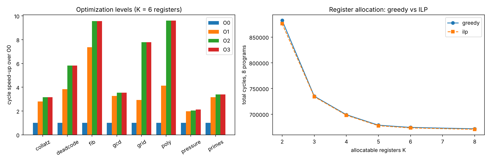

# Track F results (generated by run_experiments.py)

Python 3.13.18. Cycle costs: mul 3, div/mod 20, ld/st 3, other 1. Every row's output was compared with the reference AST interpreter.

## Exp 1 — optimization levels (geometric means over 8 programs, relative to O0)

| level | programs | all_outputs_identical | geomean_cycle_speedup | geomean_instr_reduction | geomean_size_reduction | total_loads_stores | mean_compile_ms |
|---|---|---|---|---|---|---|---|
| O0 | 8 | True | 1.0 | 1.0 | 1.0 | 565146 | 0.73 |
| O1 | 8 | True | 3.44 | 3.06 | 2.76 | 7334 | 0.95 |
| O2 | 8 | True | 4.89 | 4.95 | 4.7 | 2108 | 2.43 |
| O3 | 8 | True | 4.91 | 5.0 | 4.73 | 1808 | 14.17 |

### Per program

| program | level | static_size | instructions | cycles | loads | stores | vm_ms | compile_ms | spilled | same_output |
|---|---|---|---|---|---|---|---|---|---|---|
| collatz | O0 | 93 | 256917 | 762273 | 85638 | 73854 | 62.41 | 1.12 | 23 | True |
| collatz | O1 | 31 | 85789 | 272161 | 0 | 0 | 24.3 | 0.79 | 0 | True |
| collatz | O2 | 22 | 54756 | 241128 | 0 | 0 | 18.66 | 2.64 | 0 | True |
| collatz | O3 | 22 | 54756 | 241128 | 0 | 0 | 17.7 | 9.98 | 0 | True |
| deadcode | O0 | 106 | 25634 | 67672 | 9209 | 7210 | 5.99 | 0.81 | 25 | True |
| deadcode | O1 | 40 | 8415 | 17615 | 0 | 0 | 2.32 | 0.84 | 0 | True |
| deadcode | O2 | 13 | 3207 | 11607 | 0 | 0 | 1.08 | 1.65 | 0 | True |
| deadcode | O3 | 13 | 3207 | 11607 | 0 | 0 | 1.08 | 8.73 | 0 | True |
| fib | O0 | 83 | 55911 | 128955 | 21036 | 15486 | 12.74 | 0.55 | 20 | True |
| fib | O1 | 29 | 17498 | 17498 | 0 | 0 | 4.44 | 0.59 | 0 | True |
| fib | O2 | 20 | 13476 | 13476 | 0 | 0 | 3.74 | 1.87 | 0 | True |
| fib | O3 | 20 | 13476 | 13476 | 0 | 0 | 3.76 | 10.07 | 0 | True |
| gcd | O0 | 91 | 65707 | 183142 | 23510 | 17984 | 14.18 | 0.55 | 21 | True |
| gcd | O1 | 33 | 21750 | 56197 | 0 | 0 | 5.21 | 0.74 | 0 | True |
| gcd | O2 | 24 | 17334 | 51781 | 0 | 0 | 4.58 | 2.7 | 0 | True |
| gcd | O3 | 24 | 17334 | 51781 | 0 | 0 | 4.37 | 12.0 | 0 | True |
| grid | O0 | 123 | 117954 | 359354 | 50009 | 32291 | 28.22 | 0.61 | 33 | True |
| grid | O1 | 47 | 35776 | 122422 | 4881 | 42 | 11.96 | 1.01 | 2 | True |
| grid | O2 | 24 | 14926 | 46166 | 0 | 0 | 5.63 | 3.62 | 0 | True |
| grid | O3 | 24 | 14926 | 46166 | 0 | 0 | 7.52 | 16.34 | 0 | True |
| poly | O0 | 161 | 11158 | 29830 | 5115 | 2920 | 2.82 | 0.76 | 45 | True |
| poly | O1 | 56 | 3425 | 7233 | 500 | 103 | 1.27 | 1.34 | 4 | True |
| poly | O2 | 23 | 1906 | 3106 | 0 | 0 | 0.73 | 2.85 | 0 | True |
| poly | O3 | 23 | 1906 | 3106 | 0 | 0 | 0.75 | 16.17 | 0 | True |
| pressure | O0 | 184 | 18370 | 66150 | 6920 | 5570 | 4.48 | 0.91 | 46 | True |
| pressure | O1 | 79 | 6937 | 33353 | 1204 | 604 | 2.03 | 1.6 | 4 | True |
| pressure | O2 | 60 | 5278 | 32294 | 1354 | 754 | 1.81 | 2.08 | 5 | True |
| pressure | O3 | 57 | 4828 | 31244 | 1204 | 604 | 1.6 | 28.39 | 4 | True |
| primes | O0 | 88 | 328127 | 933032 | 126660 | 81734 | 78.45 | 0.52 | 21 | True |
| primes | O1 | 29 | 107664 | 295781 | 0 | 0 | 32.35 | 0.68 | 0 | True |
| primes | O2 | 22 | 86693 | 274810 | 0 | 0 | 29.63 | 2.05 | 0 | True |
| primes | O3 | 22 | 86693 | 274810 | 0 | 0 | 29.09 | 11.7 | 0 | True |

## Exp 2 — ablation (cycle speed-up vs no IR passes, greedy RA, K = 6)

| config | geomean_speedup_vs_no_passes | best_program | all_outputs_identical |
|---|---|---|---|
| all passes | 1.42 | grid | True |
| no passes | 1.0 | collatz | True |
| all but constprop | 1.091 | poly | True |
| all but copyprop | 1.342 | grid | True |
| all but cse | 1.341 | grid | True |
| all but strength | 1.372 | grid | True |
| all but licm | 1.313 | poly | True |
| all but dce | 1.277 | grid | True |
| only constprop | 1.03 | poly | True |
| only copyprop | 1.002 | deadcode | True |
| only cse | 1.013 | poly | True |
| only strength | 1.0 | collatz | True |
| only licm | 0.973 | grid | True |
| only dce | 1.019 | deadcode | True |

## Exp 3 — register allocation: greedy vs ILP

| k | programs | greedy_spill_cost | ilp_spill_cost | programs_where_ilp_better | greedy_cycles | ilp_cycles | programs_where_ilp_fewer_cycles | programs_where_ilp_more_cycles | greedy_ms | ilp_ms | ilp_all_optimal |
|---|---|---|---|---|---|---|---|---|---|---|---|
| 2 | 8 | 5224 | 5114 | 2 | 882571 | 876031 | 2 | 0 | 1.7 | 62.6 | True |
| 3 | 8 | 1865 | 1845 | 1 | 735109 | 734059 | 1 | 0 | 1.9 | 68.1 | True |
| 4 | 8 | 892 | 872 | 1 | 699130 | 698080 | 1 | 0 | 2.0 | 75.4 | True |
| 5 | 8 | 373 | 353 | 1 | 678682 | 677632 | 1 | 0 | 2.0 | 84.7 | True |
| 6 | 8 | 147 | 127 | 1 | 674368 | 673318 | 1 | 0 | 2.1 | 91.1 | True |
| 8 | 8 | 83 | 63 | 1 | 671656 | 670606 | 1 | 0 | 2.0 | 106.2 | True |

## Exp 4 — pass ordering (each pass applied once)

| program | no_passes | default_order_once | best_order | best_order_seq | worst_order | orders_tried | distinct_results | greedy_order | greedy_order_seq | default_to_fixpoint | search_seconds | greedy_seconds |
|---|---|---|---|---|---|---|---|---|---|---|---|---|
| collatz | 272161 | 241128 | 241128 | constprop copyprop cse strength licm dce | 243011 | 720 | 6 | 241128 | constprop strength copyprop cse licm dce | 241128 | 14.3 | 0.44 |
| deadcode | 15214 | 11607 | 11607 | constprop copyprop cse strength licm dce | 12018 | 720 | 4 | 11607 | constprop copyprop cse strength licm dce | 11607 | 1.7 | 0.05 |
| fib | 17498 | 13476 | 13476 | constprop copyprop cse strength licm dce | 15314 | 720 | 7 | 13476 | constprop copyprop cse strength licm dce | 13476 | 4.0 | 0.1 |
| gcd | 56197 | 51781 | 51781 | constprop copyprop cse strength licm dce | 53602 | 720 | 7 | 51781 | constprop copyprop cse strength licm dce | 51781 | 4.9 | 0.13 |
| grid | 122422 | 46206 | 46206 | constprop copyprop cse strength licm dce | 80853 | 720 | 22 | 77406 | licm constprop strength cse copyprop dce | 46166 | 5.0 | 0.22 |
| poly | 7233 | 3906 | 3706 | constprop cse copyprop strength licm dce | 4824 | 720 | 14 | 3706 | constprop cse strength copyprop licm dce | 3106 | 1.6 | 0.05 |
| pressure | 33353 | 32294 | 32294 | constprop copyprop cse strength licm dce | 32313 | 720 | 3 | 32294 | constprop cse strength licm dce copyprop | 32294 | 2.2 | 0.05 |
| primes | 294408 | 274810 | 274810 | constprop copyprop cse strength licm dce | 274819 | 720 | 4 | 274810 | constprop copyprop cse strength licm dce | 274810 | 21.9 | 0.66 |

## Mutation testing

See `mutation_testing.txt`.

