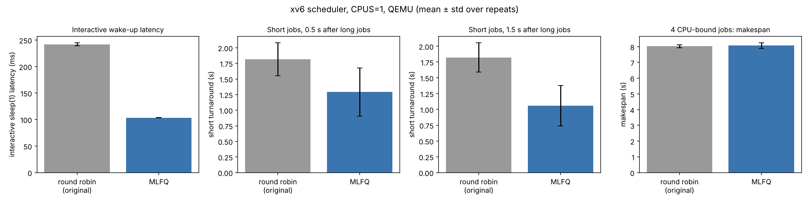
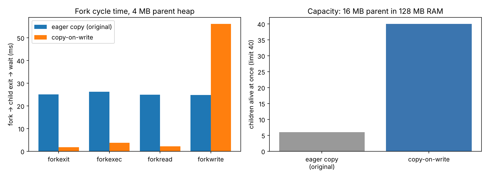

# Track G results (generated by run_benchmarks.py)

xv6-riscv under QEMU 8.2 (TCG emulation, 128 MB RAM). Times come from the RISC-V `time` CSR (10 MHz). Benchmarks use CPUS=1.

## Correctness

| variant | cpus | cowtest | usertests | usertests_mode | minutes |
|---|---|---|---|---|---|
| original | 1 | OK | ALL TESTS PASSED | full | 3.1 |
| original | 3 | OK | ALL TESTS PASSED | full | 3.9 |
| mlfq | 1 | OK | ALL TESTS PASSED | full | 3.0 |
| mlfq | 3 | OK | ALL TESTS PASSED | full | 3.6 |
| cow | 1 | OK | ALL TESTS PASSED | full | 3.0 |
| cow | 3 | OK | ALL TESTS PASSED | full | 3.7 |
| both | 1 | OK | ALL TESTS PASSED | full | 3.0 |
| both | 3 | OK | ALL TESTS PASSED | full | 3.7 |

## Feature 1 — MLFQ scheduler vs round robin

| workload | variant | metric | mean | std | n |
|---|---|---|---|---|---|
| cpu | original | cpu turnaround (s) | 7.905 | 0.148 | 20 |
| cpu | original | cpu response (ms) | 107.4 | 100.3 | 20 |
| cpu | original | cpu times scheduled | 20.9 | 1.0 | 20 |
| cpu | original | makespan (s) | 8.024 | 0.095 | 5 |
| cpu | mlfq | cpu turnaround (s) | 7.818 | 0.255 | 20 |
| cpu | mlfq | cpu response (ms) | 104.0 | 97.2 | 20 |
| cpu | mlfq | cpu times scheduled | 7.9 | 0.3 | 20 |
| cpu | mlfq | makespan (s) | 8.069 | 0.175 | 5 |
| mixed | original | cpu turnaround (s) | 9.028 | 0.195 | 15 |
| mixed | original | cpu response (ms) | 71.3 | 70.4 | 15 |
| mixed | original | cpu times scheduled | 31.2 | 1.2 | 15 |
| mixed | original | interactive turnaround (s) | 10.017 | 0.114 | 10 |
| mixed | original | interactive response (ms) | 257.7 | 35.2 | 10 |
| mixed | original | interactive sleep(1) latency (ms) | 241.9 | 2.8 | 10 |
| mixed | original | interactive worst latency (ms) | 306.5 | 11.0 | 10 |
| mixed | original | makespan (s) | 10.046 | 0.118 | 5 |
| mixed | mlfq | interactive turnaround (s) | 4.45 | 0.01 | 10 |
| mixed | mlfq | interactive response (ms) | 231.1 | 9.8 | 10 |
| mixed | mlfq | cpu turnaround (s) | 8.729 | 0.343 | 15 |
| mixed | mlfq | cpu response (ms) | 53.5 | 55.7 | 15 |
| mixed | mlfq | cpu times scheduled | 21 | 0.5 | 15 |
| mixed | mlfq | interactive sleep(1) latency (ms) | 103.5 | 0.1 | 10 |
| mixed | mlfq | interactive worst latency (ms) | 299.4 | 0.3 | 10 |
| mixed | mlfq | makespan (s) | 9.078 | 0.048 | 5 |
| shortlong | original | short turnaround (s) | 1.816 | 0.263 | 20 |
| shortlong | original | short response (ms) | 351.2 | 112.3 | 20 |
| shortlong | original | short times scheduled | 3.8 | 0.8 | 20 |
| shortlong | original | long turnaround (s) | 9.182 | 0.085 | 10 |
| shortlong | original | long response (ms) | 22.9 | 37.2 | 10 |
| shortlong | original | long times scheduled | 41.2 | 1.1 | 10 |
| shortlong | original | makespan (s) | 9.233 | 0.078 | 5 |
| shortlong | mlfq | short turnaround (s) | 1.29 | 0.384 | 20 |
| shortlong | mlfq | short response (ms) | 150.6 | 111.9 | 20 |
| shortlong | mlfq | short times scheduled | 2.5 | 0.5 | 20 |
| shortlong | mlfq | long turnaround (s) | 8.886 | 0.468 | 10 |
| shortlong | mlfq | long response (ms) | 28.0 | 35.5 | 10 |
| shortlong | mlfq | long times scheduled | 15.2 | 0.4 | 10 |
| shortlong | mlfq | makespan (s) | 9.307 | 0.056 | 5 |
| shortlate | original | short turnaround (s) | 1.823 | 0.231 | 20 |
| shortlate | original | short response (ms) | 351.2 | 112.0 | 20 |
| shortlate | original | short times scheduled | 3.7 | 0.7 | 20 |
| shortlate | original | long turnaround (s) | 9.105 | 0.103 | 10 |
| shortlate | original | long response (ms) | 27.2 | 30.5 | 10 |
| shortlate | original | long times scheduled | 40.7 | 1.1 | 10 |
| shortlate | original | makespan (s) | 9.163 | 0.088 | 5 |
| shortlate | mlfq | short turnaround (s) | 1.056 | 0.32 | 20 |
| shortlate | mlfq | short response (ms) | 150.5 | 111.8 | 20 |
| shortlate | mlfq | short times scheduled | 2.5 | 0.5 | 20 |
| shortlate | mlfq | long turnaround (s) | 8.909 | 0.325 | 10 |
| shortlate | mlfq | long response (ms) | 36.7 | 39.0 | 10 |
| shortlate | mlfq | long times scheduled | 18.1 | 0.8 | 10 |
| shortlate | mlfq | makespan (s) | 9.185 | 0.175 | 5 |

## Feature 2 — copy-on-write fork vs eager copy

| workload | variant | runs | fork_cycle_us | pages_copied_at_fork | cow_faults | cow_copies | min_free_pages | live_children |
|---|---|---|---|---|---|---|---|---|
| forkexit | original | 5 | 25003 ± 1885 | 20580 | 0 | 0 | 30434 |  |
| forkexit | cow | 5 | 1734 ± 267 | 0 | 41 | 21 | 31462 |  |
| forkexec | original | 5 | 26233 ± 1449 | 20580 | 0 | 0 | 30434 |  |
| forkexec | cow | 5 | 3757 ± 431 | 0 | 41 | 21 | 31462 |  |
| forkread | original | 5 | 24887 ± 1821 | 20580 | 0 | 0 | 30434 |  |
| forkread | cow | 5 | 2141 ± 392 | 0 | 41 | 21 | 31462 |  |
| forkwrite | original | 5 | 24701 ± 1739 | 20580 | 0 | 0 | 30434 |  |
| forkwrite | cow | 5 | 56107 ± 3809 | 0 | 20521 | 20501 | 31462 |  |
| capacity | original | 5 |  | 28295 | 0 | 0 | 3702 | 6 |
| capacity | cow | 5 |  | 0 | 120 | 120 | 27730 | 40 |

