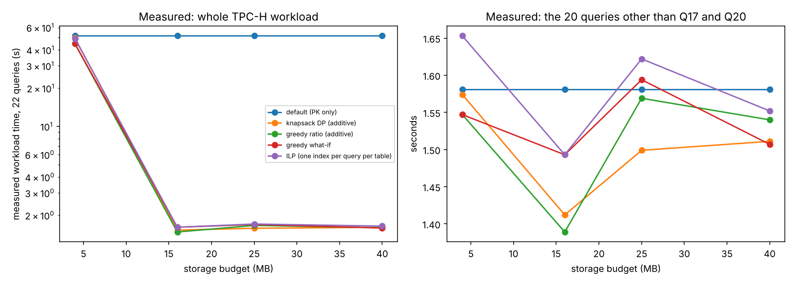

# Track H results (generated by run_experiments.py)

PostgreSQL 16.15 (Ubuntu 16.15-0ubuntu0.24.04.1) on x86_64-pc-linux-gnu, compiled by gcc (Ubuntu 13.3.0-6ubuntu2~24.04.1) 13.3.0, 64-bit. Settings: {"shared_buffers": "128MB", "work_mem": "4MB", "effective_cache_size": "4GB", "random_page_cost": "4", "max_parallel_workers_per_gather": "2", "jit": "on"}. Host: Linux-6.18.44-fc-v185-x86_64-with-glibc2.39, 2 CPUs. Data: TPC-H SF 0.1 {"region": 5, "nation": 25, "part": 20000, "supplier": 1000, "partsupp": 80000, "customer": 15000, "orders": 150000, "lineitem": 600572}; tables 129.1 MB, primary keys 18.7 MB.

44 candidate indexes; timed passes per configuration: 3 (after 1 warm-up), latency = median.

## Selection (planner-estimated cost via hypopg)

| budget_mb | method | n_indexes | est_size_mb | est_cost_reduction_pct | additive_model_value | solve_seconds | config_id | indexes |
|---|---|---|---|---|---|---|---|---|
| 4 | default (PK only) | 0 | 0 | 0.0 | 0 | 0.0 | C0 |  |
| 4 | knapsack DP (additive) | 4 | 3.8 | -0.58 | 10018 | 0.0 | C1 | supplier(s_nationkey, s_suppkey); supplier(s_nationkey); partsupp(ps_suppkey, ps_partkey); customer(c_nationkey, c_custkey) |
| 4 | greedy ratio (additive) | 6 | 3.8 | 0.05 | 9763 | 0.0 | C2 | supplier(s_nationkey, s_suppkey); supplier(s_nationkey); partsupp(ps_suppkey); customer(c_nationkey, c_custkey); part(p_brand); part(p_size) |
| 4 | greedy what-if | 6 | 3.8 | 0.05 | 9763 | 1.158 | C2 | supplier(s_nationkey, s_suppkey); partsupp(ps_suppkey); customer(c_nationkey, c_custkey); part(p_brand); part(p_size); supplier(s_nationkey) |
| 4 | ILP (one index per query per table) | 3 | 3.8 | -0.58 | 9930 | 0.011 | C3 | customer(c_nationkey, c_custkey); partsupp(ps_suppkey, ps_partkey); supplier(s_nationkey, s_suppkey) |
| 16 | default (PK only) | 0 | 0 | 0.0 | 0 | 0.0 | C0 |  |
| 16 | knapsack DP (additive) | 4 | 15.6 | 97.51 | 18947682 | 0.0 | C4 | supplier(s_nationkey, s_suppkey); supplier(s_nationkey); lineitem(l_partkey); customer(c_nationkey, c_custkey) |
| 16 | greedy ratio (additive) | 5 | 16.0 | 97.51 | 18948134 | 0.0 | C5 | lineitem(l_partkey); supplier(s_nationkey, s_suppkey); supplier(s_nationkey); customer(c_nationkey, c_custkey); customer(c_nationkey) |
| 16 | greedy what-if | 4 | 16.0 | 97.51 | 18947747 | 0.514 | C6 | lineitem(l_partkey); supplier(s_nationkey, s_suppkey); customer(c_nationkey, c_custkey); customer(c_acctbal) |
| 16 | ILP (one index per query per table) | 4 | 16.0 | 97.51 | 18947747 | 0.02 | C6 | customer(c_acctbal); customer(c_nationkey, c_custkey); lineitem(l_partkey); supplier(s_nationkey, s_suppkey) |
| 25 | default (PK only) | 0 | 0 | 0.0 | 0 | 0.0 | C0 |  |
| 25 | knapsack DP (additive) | 4 | 24.6 | 97.98 | 19039745 | 0.0 | C7 | supplier(s_nationkey, s_suppkey); supplier(s_nationkey); lineitem(l_partkey, l_suppkey); customer(c_nationkey, c_custkey) |
| 25 | greedy ratio (additive) | 8 | 24.9 | 97.54 | 18967969 | 0.0 | C8 | lineitem(l_partkey); supplier(s_nationkey, s_suppkey); supplier(s_nationkey); partsupp(ps_suppkey); partsupp(ps_suppkey, ps_partkey); customer(c_nationkey, c_custkey); partsupp(ps_suppkey, ps_supplycost); part(p_brand) |
| 25 | greedy what-if | 11 | 25.0 | 97.61 | 18961874 | 2.514 | C9 | lineitem(l_partkey); supplier(s_nationkey, s_suppkey); partsupp(ps_suppkey); customer(c_nationkey, c_custkey); orders(o_custkey); part(p_brand); part(p_size); part(p_container); part(p_type); customer(c_acctbal); customer(c_mktsegment) |
| 25 | ILP (one index per query per table) | 4 | 25.0 | 97.98 | 19039810 | 0.012 | C10 | customer(c_acctbal); customer(c_nationkey, c_custkey); lineitem(l_partkey, l_suppkey); supplier(s_nationkey, s_suppkey) |
| 40 | default (PK only) | 0 | 0 | 0.0 | 0 | 0.0 | C0 |  |
| 40 | knapsack DP (additive) | 5 | 39.6 | 97.98 | 37985160 | 0.001 | C11 | supplier(s_nationkey, s_suppkey); supplier(s_nationkey); lineitem(l_partkey, l_suppkey); lineitem(l_partkey); customer(c_nationkey, c_custkey) |
| 40 | greedy ratio (additive) | 9 | 39.8 | 98.01 | 36214540 | 0.0 | C12 | lineitem(l_partkey); lineitem(l_suppkey); supplier(s_nationkey, s_suppkey); supplier(s_nationkey); partsupp(ps_suppkey); partsupp(ps_suppkey, ps_partkey); customer(c_nationkey, c_custkey); partsupp(ps_suppkey, ps_supplycost); part(p_brand) |
| 40 | greedy what-if | 13 | 40.0 | 98.08 | 36208533 | 3.134 | C13 | lineitem(l_partkey); supplier(s_nationkey, s_suppkey); lineitem(l_suppkey); partsupp(ps_suppkey); customer(c_nationkey, c_custkey); orders(o_custkey); part(p_brand); part(p_size); part(p_container); part(p_type); customer(c_acctbal); customer(c_mktsegment); supplier(s_nationkey) |
| 40 | ILP (one index per query per table) | 11 | 39.7 | 98.09 | 19063842 | 0.026 | C14 | customer(c_acctbal); customer(c_nationkey, c_custkey); lineitem(l_partkey, l_suppkey); orders(o_custkey); orders(o_orderdate); part(p_brand); part(p_size); part(p_type); partsupp(ps_suppkey); partsupp(ps_suppkey, ps_partkey); supplier(s_nationkey, s_suppkey) |

## Measured (indexes built for real)

| config_id | n_indexes | real_size_mb | build_seconds | workload_seconds | throughput_qpm | q17_s | q20_s | others_s | results_identical | used_by |
|---|---|---|---|---|---|---|---|---|---|---|
| C0 | 0 | 0.0 | 0.0 | 51.586 | 25.6 | 21.692 | 28.092 | 1.581 | 22/22 | default (PK only) @ 4 MB | default (PK only) @ 16 MB | default (PK only) @ 25 MB | default (PK only) @ 40 MB |
| C1 | 4 | 2.1 | 0.07 | 49.714 | 26.6 | 21.337 | 26.753 | 1.574 | 22/22 | knapsack DP (additive) @ 4 MB |
| C2 | 6 | 1.2 | 0.09 | 44.804 | 29.5 | 15.334 | 25.098 | 1.547 | 22/22 | greedy ratio (additive) @ 4 MB | greedy what-if @ 4 MB |
| C3 | 3 | 2.1 | 0.05 | 49.144 | 26.9 | 19.961 | 27.446 | 1.653 | 22/22 | ILP (one index per query per table) @ 4 MB |
| C4 | 4 | 4.7 | 0.21 | 1.529 | 863.6 | 0.061 | 0.031 | 1.412 | 22/22 | knapsack DP (additive) @ 16 MB |
| C5 | 5 | 4.8 | 0.24 | 1.477 | 893.9 | 0.053 | 0.028 | 1.389 | 22/22 | greedy ratio (additive) @ 16 MB |
| C6 | 4 | 5.0 | 0.18 | 1.61 | 819.7 | 0.062 | 0.035 | 1.493 | 22/22 | greedy what-if @ 16 MB | ILP (one index per query per table) @ 16 MB |
| C7 | 4 | 6.2 | 0.22 | 1.58 | 835.4 | 0.061 | 0.012 | 1.499 | 22/22 | knapsack DP (additive) @ 25 MB |
| C8 | 8 | 9.6 | 0.39 | 1.664 | 793.5 | 0.063 | 0.033 | 1.569 | 22/22 | greedy ratio (additive) @ 25 MB |
| C9 | 11 | 7.5 | 0.39 | 1.693 | 779.9 | 0.07 | 0.034 | 1.594 | 22/22 | greedy what-if @ 25 MB |
| C10 | 4 | 6.5 | 0.24 | 1.707 | 773.4 | 0.073 | 0.014 | 1.622 | 22/22 | ILP (one index per query per table) @ 25 MB |
| C11 | 5 | 10.5 | 0.46 | 1.609 | 820.5 | 0.068 | 0.013 | 1.511 | 22/22 | knapsack DP (additive) @ 40 MB |
| C12 | 9 | 13.7 | 0.61 | 1.596 | 827.1 | 0.063 | 0.041 | 1.54 | 22/22 | greedy ratio (additive) @ 40 MB |
| C13 | 13 | 11.6 | 0.64 | 1.587 | 832.0 | 0.062 | 0.042 | 1.507 | 22/22 | greedy what-if @ 40 MB |
| C14 | 11 | 11.5 | 0.47 | 1.644 | 803.0 | 0.068 | 0.014 | 1.552 | 22/22 | ILP (one index per query per table) @ 40 MB |
| C15 | 44 | 201.4 | 7.39 | 1.353 | 975.5 | 0.001 | 0.016 | 1.322 | 22/22 | all candidates (no budget) |

