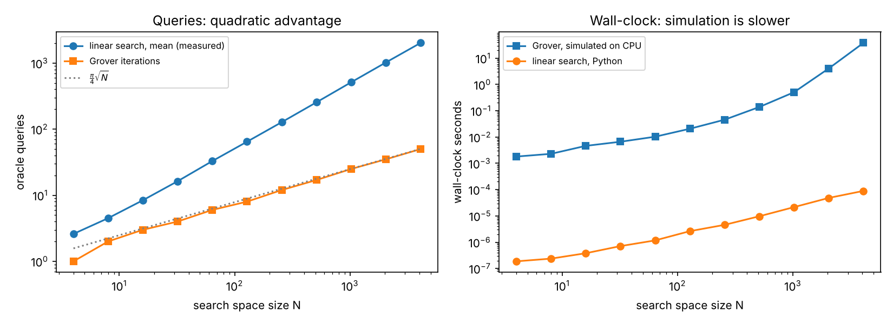
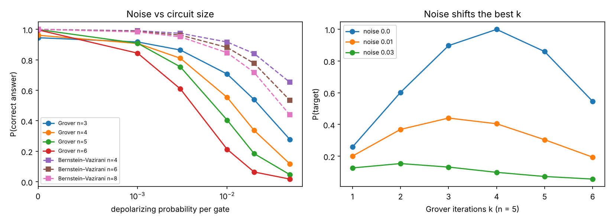
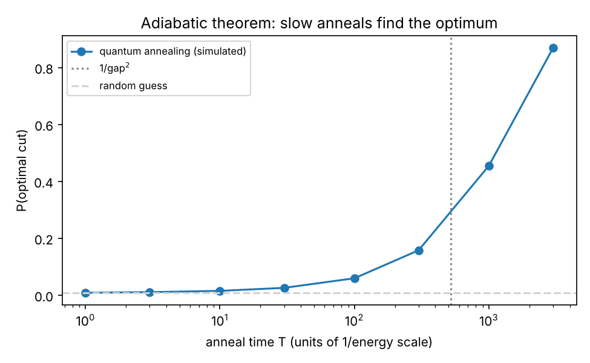
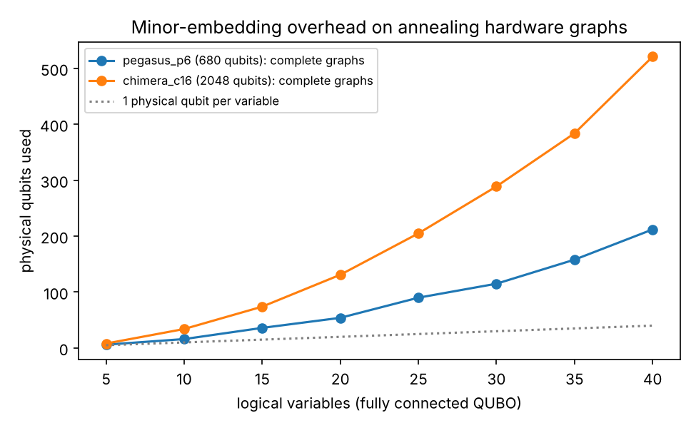

# Track I results (generated by run_experiments.py)

PennyLane 0.45.1. **All quantum results are classical simulations**; no real quantum hardware was used. 'Noise' means a simulated depolarizing noise model.

## Exp 1 — every algorithm taught

`classical_queries_deterministic` = worst case for the best deterministic classical algorithm.

| algorithm | n | quantum_queries | classical_queries_deterministic | result | correct |
|---|---|---|---|---|---|
| Deutsch–Jozsa | 2 | 1 | 3 | P(0..0): constant 1.000, balanced 0.000 | True |
| Deutsch–Jozsa | 3 | 1 | 5 | P(0..0): constant 1.000, balanced 0.000 | True |
| Deutsch–Jozsa | 4 | 1 | 9 | P(0..0): constant 1.000, balanced 0.000 | True |
| Deutsch–Jozsa | 5 | 1 | 17 | P(0..0): constant 1.000, balanced 0.000 | True |
| Deutsch–Jozsa | 6 | 1 | 33 | P(0..0): constant 1.000, balanced 0.000 | True |
| Bernstein–Vazirani | 2 | 1 | 2 | secret 01 recovered with P = 1.000 | True |
| Bernstein–Vazirani | 4 | 1 | 4 | secret 1001 recovered with P = 1.000 | True |
| Bernstein–Vazirani | 6 | 1 | 6 | secret 101110 recovered with P = 1.000 | True |
| Bernstein–Vazirani | 8 | 1 | 8 | secret 01010000 recovered with P = 1.000 | True |
| QFT (hand-written) | 3 |  |  | max |mine - qml.QFT| = 1.2e-16 | True |
| QFT (hand-written) | 5 |  |  | max |mine - qml.QFT| = 1.4e-16 | True |
| QPE (hand-written) | 4 | 7 |  | phase 0.6250 -> 0.6250 (P = 1.000, resolution 1/8) | True |
| QPE (hand-written) | 6 | 31 |  | phase 0.3000 -> 0.3125 (P = 0.573, resolution 1/32) | True |
| QPE (hand-written) | 9 | 255 |  | phase 0.3333 -> 0.3320 (P = 0.684, resolution 1/256) | True |
| Grover (hand-written) | 3 | 2 | 7 | P(target) = 0.945 | True |
| Grover (hand-written) | 4 | 3 | 15 | P(target) = 0.961 | True |
| Grover (hand-written) | 5 | 4 | 31 | P(target) = 0.999 | True |
| Grover (hand-written) | 6 | 6 | 63 | P(target) = 0.997 | True |
| Shor N=15 (order finding by QPE) | 12 |  |  | a=2: order 4, P(factors per run) = 0.50, factors [(3, 5)] | True |
| Shor N=15 (order finding by QPE) | 12 |  |  | a=7: order 4, P(factors per run) = 0.50, factors [(3, 5)] | True |
| Shor N=15 (order finding by QPE) | 12 |  |  | a=11: order 2, P(factors per run) = 0.50, factors [(3, 5)] | True |
| Shor N=15 (order finding by QPE) | 12 |  |  | a=13: order 4, P(factors per run) = 0.50, factors [(3, 5)] | True |
| Shor N=15 (order finding by QPE) | 12 |  |  | a=14: order 2, P(factors per run) = 0.00, factors none (a^(r/2) = -1 mod 15) | True |

## Exp 2 — Grover vs linear search

Classical queries measured over 2,000 random targets. Gate counts after decomposition into 1- and 2-qubit gates (no ancilla qubits).

| n_qubits | N | grover_queries | grover_p_success | linear_mean_queries | linear_worst_queries | query_ratio | grover_gates_decomposed | grover_2q_gates | grover_sim_seconds | linear_seconds |
|---|---|---|---|---|---|---|---|---|---|---|
| 2 | 4 | 1 | 1.0 | 2.6 | 4 | 2.55 | 12 | 2 | 0.00181 | 1.87e-07 |
| 3 | 8 | 2 | 0.9453 | 4.5 | 8 | 2.23 | 87 | 24 | 0.0023 | 2.37e-07 |
| 4 | 16 | 3 | 0.9613 | 8.4 | 16 | 2.8 | 442 | 120 | 0.00462 | 3.8e-07 |
| 5 | 32 | 4 | 0.9992 | 16.3 | 32 | 4.08 | 1181 | 352 | 0.00663 | 7.1e-07 |
| 6 | 64 | 6 | 0.9966 | 32.9 | 64 | 5.48 | 3738 | 1248 | 0.0103 | 1.17e-06 |
| 7 | 128 | 8 | 0.9956 | 64.6 | 128 | 8.08 | 9047 | 3200 | 0.0207 | 2.63e-06 |
| 8 | 256 | 12 | 0.9999 | 127.6 | 256 | 10.63 | 22544 | 8256 | 0.0457 | 4.57e-06 |
| 9 | 512 | 17 | 0.9994 | 254.9 | 512 | 15.0 |  |  | 0.139 | 9.68e-06 |
| 10 | 1024 | 25 | 0.9995 | 512.6 | 1024 | 20.5 |  |  | 0.508 | 2.16e-05 |
| 11 | 2048 | 35 | 1.0 | 1022.1 | 2048 | 29.2 |  |  | 4.07 | 4.83e-05 |
| 12 | 4096 | 50 | 0.9999 | 2019.4 | 4096 | 40.39 |  |  | 38.2 | 8.94e-05 |

## Exp 3 — hardware noise model

Depolarizing channel after every *logical* gate (the multi-controlled Z counts as one gate; on hardware it decomposes into many, so real error would be larger).

| algorithm | n | noise | iterations | p_success | random_guess |
|---|---|---|---|---|---|
| Grover | 3 | 0.0 |  | 0.9453 | 0.125 |
| Grover | 3 | 0.001 |  | 0.9175 | 0.125 |
| Grover | 3 | 0.003 |  | 0.8647 | 0.125 |
| Grover | 3 | 0.01 |  | 0.7069 | 0.125 |
| Grover | 3 | 0.02 |  | 0.5393 | 0.125 |
| Grover | 3 | 0.05 |  | 0.2783 | 0.125 |
| Grover | 4 | 0.0 |  | 0.9613 | 0.0625 |
| Grover | 4 | 0.001 |  | 0.9078 | 0.0625 |
| Grover | 4 | 0.003 |  | 0.8106 | 0.0625 |
| Grover | 4 | 0.01 |  | 0.5536 | 0.0625 |
| Grover | 4 | 0.02 |  | 0.337 | 0.0625 |
| Grover | 4 | 0.05 |  | 0.118 | 0.0625 |
| Grover | 5 | 0.0 |  | 0.9992 | 0.0312 |
| Grover | 5 | 0.001 |  | 0.9089 | 0.0312 |
| Grover | 5 | 0.003 |  | 0.7541 | 0.0312 |
| Grover | 5 | 0.01 |  | 0.4047 | 0.0312 |
| Grover | 5 | 0.02 |  | 0.1847 | 0.0312 |
| Grover | 5 | 0.05 |  | 0.047 | 0.0312 |
| Grover | 6 | 0.0 |  | 0.9966 | 0.0156 |
| Grover | 6 | 0.001 |  | 0.844 | 0.0156 |
| Grover | 6 | 0.003 |  | 0.6096 | 0.0156 |
| Grover | 6 | 0.01 |  | 0.2127 | 0.0156 |
| Grover | 6 | 0.02 |  | 0.064 | 0.0156 |
| Grover | 6 | 0.05 |  | 0.0176 | 0.0156 |
| Bernstein–Vazirani | 4 | 0.0 |  | 1.0 | 0.0625 |
| Bernstein–Vazirani | 4 | 0.001 |  | 0.9914 | 0.0625 |
| Bernstein–Vazirani | 4 | 0.003 |  | 0.9744 | 0.0625 |
| Bernstein–Vazirani | 4 | 0.01 |  | 0.9172 | 0.0625 |
| Bernstein–Vazirani | 4 | 0.02 |  | 0.8418 | 0.0625 |
| Bernstein–Vazirani | 4 | 0.05 |  | 0.6534 | 0.0625 |
| Bernstein–Vazirani | 6 | 0.0 |  | 1.0 | 0.0156 |
| Bernstein–Vazirani | 6 | 0.001 |  | 0.9874 | 0.0156 |
| Bernstein–Vazirani | 6 | 0.003 |  | 0.9627 | 0.0156 |
| Bernstein–Vazirani | 6 | 0.01 |  | 0.8813 | 0.0156 |
| Bernstein–Vazirani | 6 | 0.02 |  | 0.7772 | 0.0156 |
| Bernstein–Vazirani | 6 | 0.05 |  | 0.5356 | 0.0156 |
| Bernstein–Vazirani | 8 | 0.0 |  | 1.0 | 0.0039 |
| Bernstein–Vazirani | 8 | 0.001 |  | 0.9835 | 0.0039 |
| Bernstein–Vazirani | 8 | 0.003 |  | 0.9513 | 0.0039 |
| Bernstein–Vazirani | 8 | 0.01 |  | 0.8468 | 0.0039 |
| Bernstein–Vazirani | 8 | 0.02 |  | 0.7176 | 0.0039 |
| Bernstein–Vazirani | 8 | 0.05 |  | 0.4392 | 0.0039 |
| Grover n=5, k iterations | 5 | 0.0 | 1 | 0.2583 | 0.0312 |
| Grover n=5, k iterations | 5 | 0.0 | 2 | 0.6024 | 0.0312 |
| Grover n=5, k iterations | 5 | 0.0 | 3 | 0.8969 | 0.0312 |
| Grover n=5, k iterations | 5 | 0.0 | 4 | 0.9992 | 0.0312 |
| Grover n=5, k iterations | 5 | 0.0 | 5 | 0.8596 | 0.0312 |
| Grover n=5, k iterations | 5 | 0.0 | 6 | 0.5459 | 0.0312 |
| Grover n=5, k iterations | 5 | 0.01 | 1 | 0.2009 | 0.0312 |
| Grover n=5, k iterations | 5 | 0.01 | 2 | 0.3691 | 0.0312 |
| Grover n=5, k iterations | 5 | 0.01 | 3 | 0.4406 | 0.0312 |
| Grover n=5, k iterations | 5 | 0.01 | 4 | 0.4047 | 0.0312 |
| Grover n=5, k iterations | 5 | 0.01 | 5 | 0.304 | 0.0312 |
| Grover n=5, k iterations | 5 | 0.01 | 6 | 0.1942 | 0.0312 |
| Grover n=5, k iterations | 5 | 0.03 | 1 | 0.1264 | 0.0312 |
| Grover n=5, k iterations | 5 | 0.03 | 2 | 0.1538 | 0.0312 |
| Grover n=5, k iterations | 5 | 0.03 | 3 | 0.1317 | 0.0312 |
| Grover n=5, k iterations | 5 | 0.03 | 4 | 0.0986 | 0.0312 |
| Grover n=5, k iterations | 5 | 0.03 | 5 | 0.0724 | 0.0312 |
| Grover n=5, k iterations | 5 | 0.03 | 6 | 0.0562 | 0.0312 |

## Exp 4 — annealing on the Track B Max-Cut (10 nodes, optimum 14)

Minimum spectral gap 0.0438 at s = 0.987, so the adiabatic time scale 1/gap² ≈ 520.5. Seconds for simulated annealing are per read.

| method | setting | p_optimal | approx_ratio | seconds |
|---|---|---|---|---|
| brute force (classical) | all 2^10 states | 1.0 | 1.0 | 0.000208 |
| quantum annealing (exact simulation) | anneal time T = 1 | 0.0086 | 0.6855 | 0.0627 |
| quantum annealing (exact simulation) | anneal time T = 3 | 0.0108 | 0.7029 | 0.0613 |
| quantum annealing (exact simulation) | anneal time T = 10 | 0.0154 | 0.7284 | 0.0614 |
| quantum annealing (exact simulation) | anneal time T = 30 | 0.0259 | 0.7649 | 0.186 |
| quantum annealing (exact simulation) | anneal time T = 100 | 0.0596 | 0.8214 | 0.613 |
| quantum annealing (exact simulation) | anneal time T = 300 | 0.1578 | 0.8857 | 2.01 |
| quantum annealing (exact simulation) | anneal time T = 1000 | 0.4547 | 0.9525 | 6.49 |
| quantum annealing (exact simulation) | anneal time T = 3000 | 0.8684 | 0.9904 | 19.6 |
| simulated annealing (classical) | 3 sweeps, 100 reads | 0.46 | 0.9536 | 0.00011 |
| simulated annealing (classical) | 10 sweeps, 100 reads | 0.77 | 0.9829 | 0.000252 |
| simulated annealing (classical) | 30 sweeps, 100 reads | 0.97 | 0.9979 | 0.000635 |
| simulated annealing (classical) | 100 sweeps, 100 reads | 1.0 | 1.0 | 0.00198 |
| simulated annealing (classical) | 300 sweeps, 100 reads | 1.0 | 1.0 | 0.00702 |
| simulated annealing (classical) | 1000 sweeps, 100 reads | 1.0 | 1.0 | 0.0225 |

## Exp 5 — embedding QUBOs on annealing hardware graphs (minorminer)

| hardware | problem | logical_vars | logical_couplings | physical_qubits | overhead | max_chain |
|---|---|---|---|---|---|---|
| pegasus_p6 (680 qubits) | Track B Max-Cut (10 nodes, 19 edges) | 10 | 19 | 11 | 1.1 | 2 |
| pegasus_p6 (680 qubits) | complete graph K5 | 5 | 10 | 6 | 1.2 | 2 |
| pegasus_p6 (680 qubits) | complete graph K10 | 10 | 45 | 16 | 1.6 | 2 |
| pegasus_p6 (680 qubits) | complete graph K15 | 15 | 105 | 36 | 2.4 | 3 |
| pegasus_p6 (680 qubits) | complete graph K20 | 20 | 190 | 54 | 2.7 | 3 |
| pegasus_p6 (680 qubits) | complete graph K25 | 25 | 300 | 90 | 3.6 | 4 |
| pegasus_p6 (680 qubits) | complete graph K30 | 30 | 435 | 115 | 3.83 | 5 |
| pegasus_p6 (680 qubits) | complete graph K35 | 35 | 595 | 158 | 4.51 | 6 |
| pegasus_p6 (680 qubits) | complete graph K40 | 40 | 780 | 212 | 5.3 | 7 |
| pegasus_p6 (680 qubits) | knapsack QUBO, 4 items (+7 slack) | 11 | 55 | 21 | 1.91 | 3 |
| pegasus_p6 (680 qubits) | knapsack QUBO, 8 items (+8 slack) | 16 | 120 | 38 | 2.38 | 3 |
| pegasus_p6 (680 qubits) | knapsack QUBO, 12 items (+9 slack) | 21 | 210 | 56 | 2.67 | 3 |
| pegasus_p6 (680 qubits) | knapsack QUBO, 16 items (+9 slack) | 25 | 300 | 90 | 3.6 | 4 |
| pegasus_p6 (680 qubits) | knapsack QUBO, 20 items (+9 slack) | 29 | 406 | 109 | 3.76 | 5 |
| chimera_c16 (2048 qubits) | Track B Max-Cut (10 nodes, 19 edges) | 10 | 19 | 19 | 1.9 | 3 |
| chimera_c16 (2048 qubits) | complete graph K5 | 5 | 10 | 8 | 1.6 | 2 |
| chimera_c16 (2048 qubits) | complete graph K10 | 10 | 45 | 34 | 3.4 | 4 |
| chimera_c16 (2048 qubits) | complete graph K15 | 15 | 105 | 74 | 4.93 | 6 |
| chimera_c16 (2048 qubits) | complete graph K20 | 20 | 190 | 131 | 6.55 | 8 |
| chimera_c16 (2048 qubits) | complete graph K25 | 25 | 300 | 205 | 8.2 | 10 |
| chimera_c16 (2048 qubits) | complete graph K30 | 30 | 435 | 289 | 9.63 | 12 |
| chimera_c16 (2048 qubits) | complete graph K35 | 35 | 595 | 384 | 10.97 | 13 |
| chimera_c16 (2048 qubits) | complete graph K40 | 40 | 780 | 521 | 13.03 | 16 |
| chimera_c16 (2048 qubits) | knapsack QUBO, 4 items (+7 slack) | 11 | 55 | 42 | 3.82 | 5 |
| chimera_c16 (2048 qubits) | knapsack QUBO, 8 items (+8 slack) | 16 | 120 | 80 | 5.0 | 6 |
| chimera_c16 (2048 qubits) | knapsack QUBO, 12 items (+9 slack) | 21 | 210 | 143 | 6.81 | 8 |
| chimera_c16 (2048 qubits) | knapsack QUBO, 16 items (+9 slack) | 25 | 300 | 205 | 8.2 | 10 |
| chimera_c16 (2048 qubits) | knapsack QUBO, 20 items (+9 slack) | 29 | 406 | 268 | 9.24 | 11 |

## Exp 6 — QML vs classical (same splits, test accuracy, mean ± std over seeds)

Quantum training time is the time to *simulate* the circuits. VQC circuit evaluations are the parameter-shift count real hardware would need; kernel evaluations are one circuit per pair of points.

| dataset | model | kind | accuracy | train_seconds | params | circuit_evals_train | circuit_evals_test |
|---|---|---|---|---|---|---|---|
| moons | logistic regression | classical | 0.870 ± 0.012 | 0.00243 | 3 | 0 | 0 |
| moons | SVM (RBF kernel) | classical | 0.950 ± 0.011 | 0.00115 | 46 | 0 | 0 |
| moons | MLP (1 hidden layer, 8 units) | classical | 0.860 ± 0.023 | 0.171 | 33 | 0 | 0 |
| moons | variational classifier (VQC) | quantum (simulated) | 0.877 ± 0.025 | 14.9 | 19 | 35520 | 60 |
| moons | quantum kernel + SVM | quantum (simulated) | 0.893 ± 0.025 | 27.0 | 59 | 9730 | 8400 |
| cancer | logistic regression | classical | 0.940 ± 0.048 | 0.00271 | 5 | 0 | 0 |
| cancer | SVM (RBF kernel) | classical | 0.937 ± 0.036 | 0.00122 | 47 | 0 | 0 |
| cancer | MLP (1 hidden layer, 8 units) | classical | 0.967 ± 0.038 | 0.303 | 49 | 0 | 0 |
| cancer | variational classifier (VQC) | quantum (simulated) | 0.890 ± 0.040 | 28.5 | 37 | 70080 | 60 |
| cancer | quantum kernel + SVM | quantum (simulated) | 0.853 ± 0.032 | 83.4 | 90 | 9730 | 8400 |

